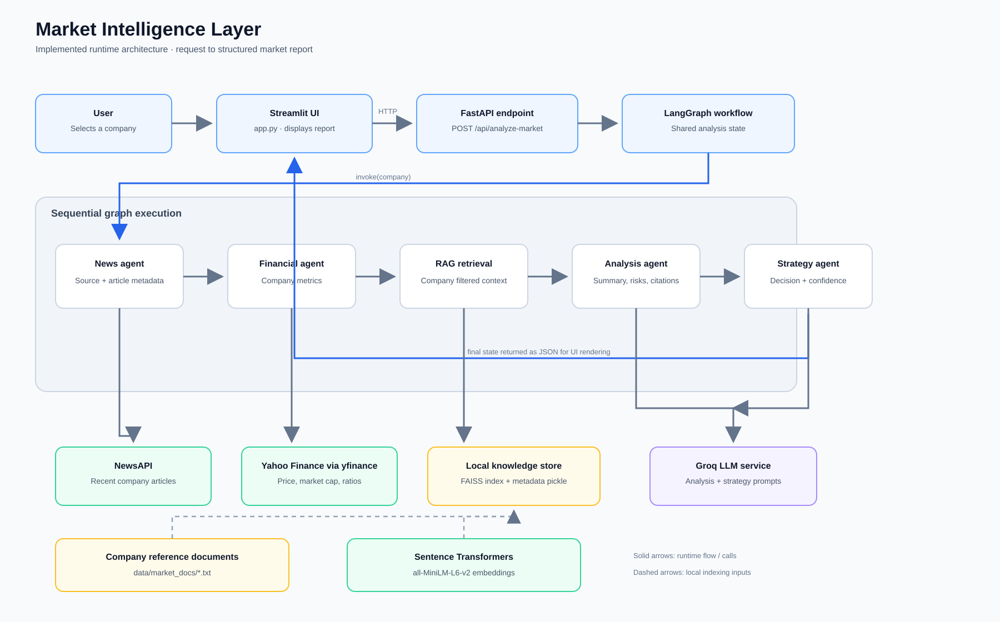

# Market Intelligence Layer: High-Level Architecture

## Overview

This repository implements a Python market-analysis application with a Streamlit user interface, a FastAPI endpoint, and a LangGraph workflow. The workflow gathers news and financial data, retrieves company context from a local FAISS index, asks a Groq-hosted LLM to produce analysis and a strategy, and returns the resulting state as JSON.

## Architecture diagram

## Request and data flow

1. The Streamlit app lets the user choose Apple, Tesla, Amazon, Google, or Nvidia. It posts the company and a generated question to `POST /api/analyze-market`.
2. The FastAPI route creates an initial state containing the company and invokes the compiled LangGraph workflow.
3. The graph runs the news agent, financial data agent, RAG-enabled analysis node, and strategy agent in sequence. Each node adds fields to the shared state.
4. The news tool calls NewsAPI. The financial tool uses `yfinance` to retrieve company metrics. The retrieval node searches the local FAISS index and filters results by company filename.
5. The analysis agent formats the retrieved text as citations and combines it with news and financial data in an analysis prompt. The strategy agent uses the analysis and a heuristic confidence score to prompt for an investment decision.
6. The route returns the final graph state as JSON. Streamlit renders financial metrics, summary, risks, opportunities, citations, and strategy.

## Main code boundaries

| Area | Responsibility | Key files |
| --- | --- | --- |
| User interface | Company selection, API call, report rendering | `app.py` |
| HTTP API | Request validation and graph invocation | `app/main.py`, `app/api/routes.py`, `app/schemas/request_schema.py` |
| Orchestration and state | Sequential workflow and shared state | `app/workflows/agent_graph.py`, `app/state.py` |
| Agents | News enrichment, financial retrieval, synthesis, recommendation | `app/agents/` |
| External tools | NewsAPI, yfinance, FAISS retrieval helper | `app/tools/` |
| Services | Groq LLM, embeddings, FAISS persistence/search | `app/services/` |
| Prompts/configuration | Prompt templates and environment-backed settings | `app/prompts/`, `app/config/settings.py` |
| Knowledge input | Company reference text | `data/market_docs/` |

## Runtime and persistence

- `uvicorn app.main:app` creates the FastAPI application. `app/main.py` registers the API router and, on startup, chunks the company text documents and feeds them to a locally constructed `VectorStore`.
- The FAISS index and metadata are persisted at repository-root paths `faiss_index.bin` and `metadata.pkl`.
- `app/services/embedding_service.py` loads `all-MiniLM-L6-v2` from Sentence Transformers to embed both indexed documents and queries.
- LLM calls are centralized in `app/services/llm_services.py`; the Groq API key and model name come from environment variables loaded by `app/config/settings.py`.
- `Dockerfile` packages and launches the FastAPI service. The Streamlit UI is run separately using `streamlit run app.py`.

## Implementation notes and caveats

- The actual workflow is sequential: `news -> finance -> analysis -> strategy`. There is no coordinator/planner agent or parallel fan-out in the compiled graph.
- The route builds and invokes its own graph in `app/api/routes.py`; `app/main.py` also builds a graph, and `app/graph.py` defines another graph that is not used by this route.
- The route's graph imports the module-level `vector_store` from `app/services/vector_store_service.py`. Startup document loading in `app/main.py` constructs a separate `VectorStore` instance. Both use the same persistence paths, but the startup load does not directly add documents to the already-imported singleton used by retrieval during that process. The existing persisted index is what the route's singleton initially loads.
- `GraphState` currently declares company, news, financial data, analysis, and strategy; the RAG node also adds `knowledge` dynamically.
- `question` is accepted by the request model and sent by the UI, but the route initializes the workflow with only `company`, so the question does not affect analysis.
- The response schema exists but is not applied to the route; the effective response is the workflow state dictionary.
- Error handling is mixed: financial and LLM paths have fallbacks, while API/network failures may be converted into error-shaped values or empty results. The UI assumes a JSON response.

